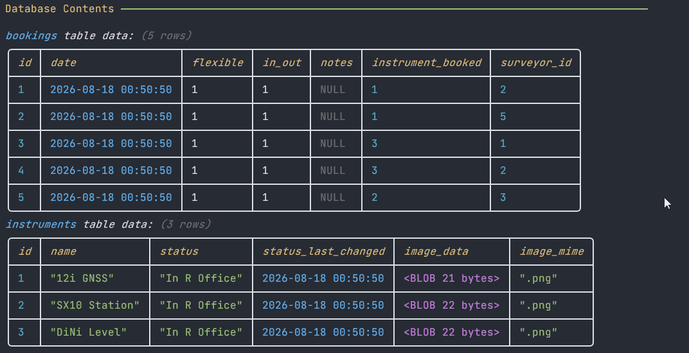
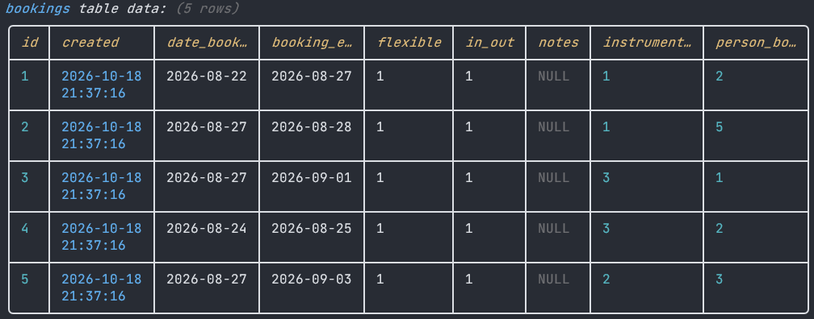
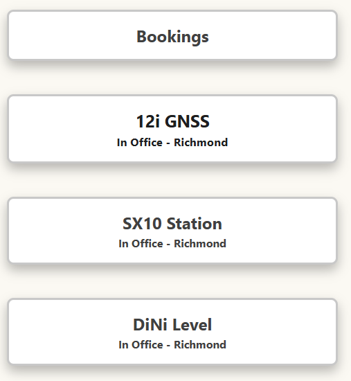

# Sprint 2 - Implement Database and Display of Test Data

## Sprint Goals

Implement the database, populated with test data. Create queries that retrieve test data, and display this on web pages as needed. Test and refine the queries and data display, so that it stands as the basis of the next sprint.

### Specific Goals

- Implement the database
- Add test data to the database
- Create the following web pages:
    - Home pages showing all instruments and a bookings nav button
    - Details page for each individual instrument, bookings page, book form, history page
      
- Develop SQL database queries to:
    - Retrieve all bookings/ past bookings
    - Retrieve specific instruments, filter bookings
    - Add bookings
    - Edit "

## Seeding the DB

### Changes / Improvements

I still couldn't get the images to work so I just removed that function. I also added a whole booking-start & booking-end thing after this gif was recorded. Status ended up being a check in/out function

## Testing Images :(

kept trying again and again to recreate from the guides the imaging function but have had no success so far. Stopped trying- the website still looks good I suppose

### Changes / Improvements

Removed the nonfunctional image routes and references.

## Testing FEATURE NAME HERE

Replace this text with notes about what you are testing, how you tested it, and the outcome of the testing

**PLACE SCREENSHOTS AND/OR ANIMATED GIFS OF THE TESTING HERE**

### Changes / Improvements

Replace this text with notes any improvements you made as a result of the testing.

**PLACE SCREENSHOTS AND/OR ANIMATED GIFS OF THE IMPROVED SYSTEM HERE**

## ETC...

## Sprint Review

Welp, I now have a base from which to work further

