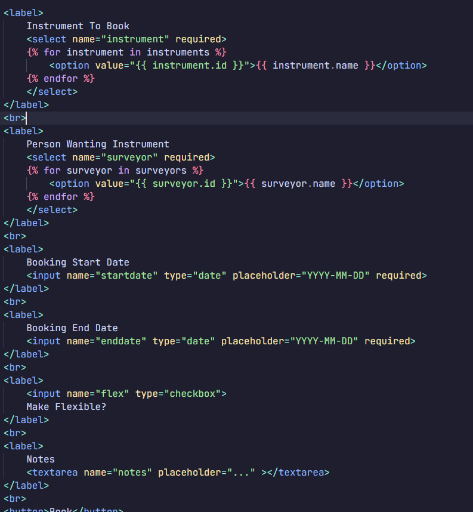
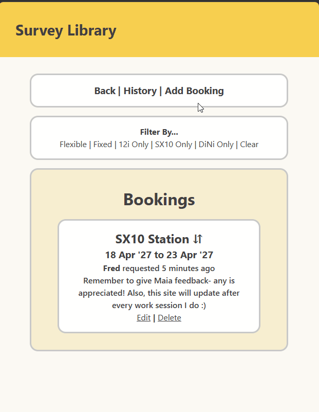
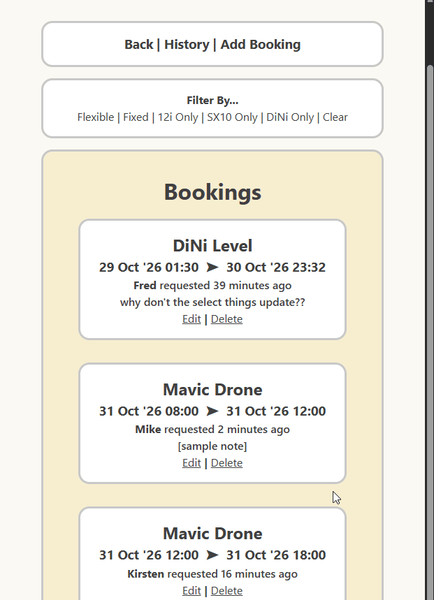

# Sprint 3 - Developing a Minimum Viable Product (MVP)

## Sprint Goals

Continue to develop the web application to the point that it provides all key functionality of the system. Test and refine it so that it can serve as the basis for the final phase of development.

### Specific Goals

- Create the following web pages:
    - Form for booking add, booking edit
    - Display of all pages
      
- Develop SQL database queries to:
    - Add a new booking
    - Edit booking
    - Edit Status / checkin

## Reviewing/ Testing

Finally able to host my website, I sent my dad a link to get his & his workmates' feedback.

Got some positive results- a calendar was suggested, although I don't quite know if that is within my capabilities. I need some more suggestions!!! ><
I did not get any reports of function issues.

### Changes / Improvements

Wondering if I could check for overlap between bookings and flag the bookings somehow?
NB: too complex.

## Testing of More Features!

As per a new bout of feedback, I got a whole lot of requests from Kirsten! As much as I would like them for something to do, a lot of them are outside the scope of this project. So, here I am testing- 
- Adding a time for the booking so instruments can be booked within one day.

Here is the booking form beforehand:

Afterward, I changed the date to datetime.

Testing:

It all worked fine first go :)

## Testing Booking Edit

I thought I knew how to do the autofill. It works for the datetimes. Why not for the dropdown options??
Also now the flexibility is playing up.

### Changes / Improvements

Talked to teacher to get the correct formatting to fix it. YAY! The dropdowns needed a 'selected' if... & the checkbox just had a typo (whoops again) - with this I fixed the notes as well to get the autofill working at last!! 

**PLACE SCREENSHOTS AND/OR ANIMATED GIFS OF THE IMPROVED SYSTEM HERE**

## ETC...

## Sprint Review

Replace this text with a statement about how the sprint has moved the project forward - key success point, any things that didn't go so well, etc.

