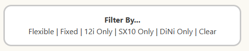
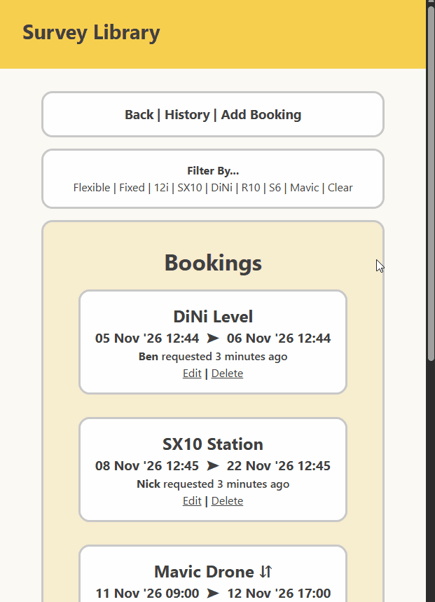
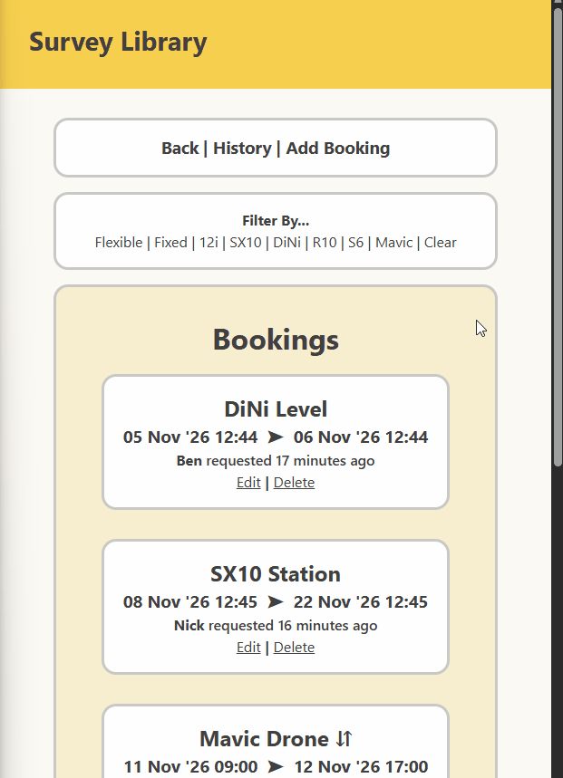
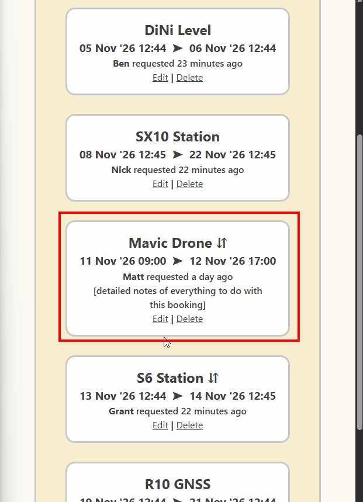
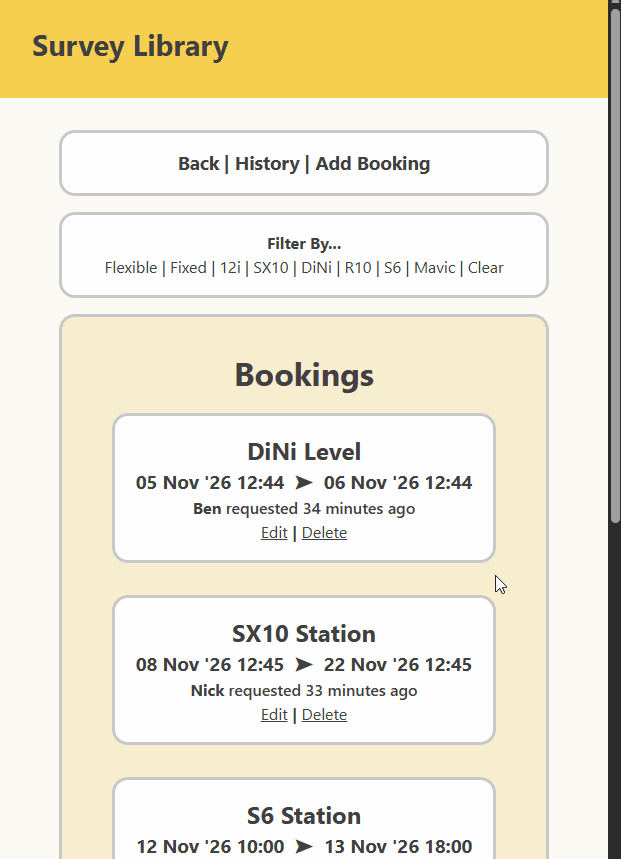

# Sprint 4 - Developing a Refined and Complete System

## Sprint Goals

Develop the system until it is fully featured, with a refined UI and it satisfies the requirements. The system will be fully tested at this point.

### Specific Goals

- Refine the design and UI of the website
- Refine the user experience (UX) of the system
- Perform final, full-system testing

### Changes / Improvements

Changed the booking screen around a bit - displayed time nicer with the date, added an arrow to break up the text blocks. Realised that the booking screen is ordered wrong so ordered them by startdate ASC rather than DESC so they are in closest time first rather than soonest booking at the bottom. Whoops...

## Testing Instrument Update Form

It did not show up with the autofill - same issue as with the bookings earlier in sprint 3. 

### Changes / Improvements

Used the same methods to fix it:

## Testing navigation- all screens

I am testing all screens- no input, just nav. 
From every screen I will go through each link - though I will only use one instrument as they all should work the same.

It all worked fine.

## Testing Filters

Prior to testing this, I noticed that I had not added all the instruments to the filter list- I had a request to add more instruments and I did so- it was only a matter of adding them to the seed data, but I copied the filters existing and changed the id to select the three newer instruments. \
Beforehand, they were like this:

Update- upon testing the filters, the new ones showed up as the SX10. - Checking again, I had stated the link as still the SX10 from my copy & paste link duplication- they all went to the same route.

I'm just happy that that was the problem... \
Back to testing. My plan is:
I will use both the bookings and history screens and go through all the filters- though both should be essentially the same. \
**Note: the arrow symbol denotes flexible bookings.**

Success!

### Changes / Improvements

Unrelated to filters, but I noticed a lack of contenuity between the way the datetime was displayed in the historical & current bookings, so I updated the historical display to match.

## Testing Booking Edit Form

I will edit a booking- I will change the name, instrument, date & time, and I will toggle the flexibility. I will also edit the note. 

Success!

## Testing Booking Deletion

I will delete a booking.

Success!

## Sprint Review

Replace this text with a statement about how the sprint has moved the project forward - key success point, any things that didn't go so well, etc.

