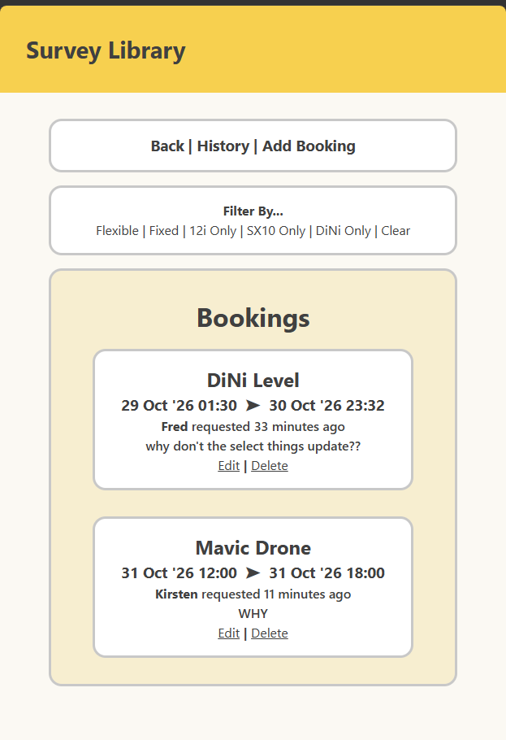
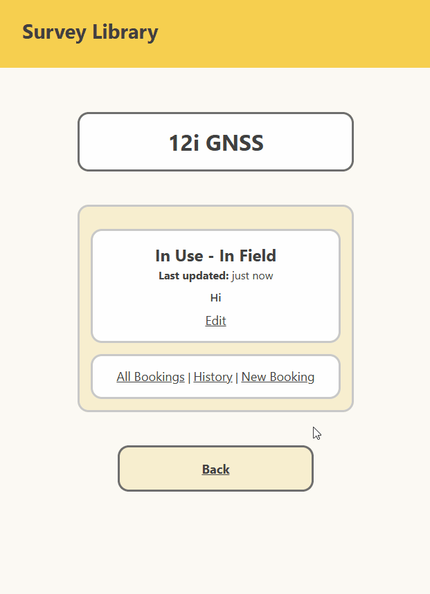
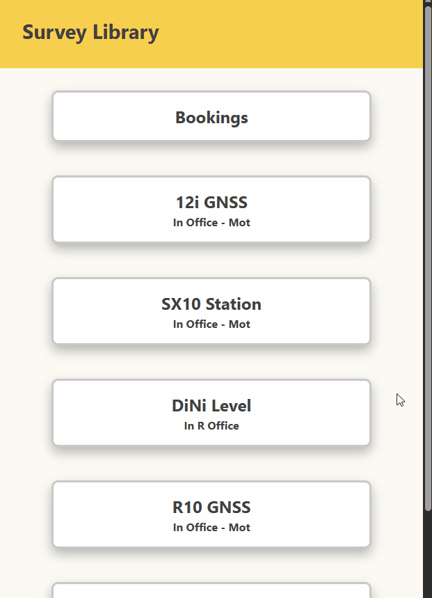

# Sprint 4 - Developing a Refined and Complete System

## Sprint Goals

Develop the system until it is fully featured, with a refined UI and it satisfies the requirements. The system will be fully tested at this point.

### Specific Goals

**Edit these goals as needed**

- Refine the design and UI of the website
- Refine the user experience (UX) of the system
- Perform final, full-system testing

### Changes / Improvements

Changed the booking screen around a bit - displayed time nicer with the date, added an arrow to break up the text blocks. Realised that the booking screen is ordered wrong so ordered them by startdate ASC rather than DESC so they are in closest time first rather than soonest booking at the bottom. Whoops...

## Testing Instrument Update Form

It did not show up with the autofill - same issue as with the bookings earlier in sprint 3. 

### Changes / Improvements

Used the same methods to fix it:

## Testing navigation- all screens

I am testing all screens- no input, just nav. 
From every screen I will go through each link - though I will only use one instrument as they all should work the same.

It all worked fine.

## Testing Filters

### Changes / Improvements

## Sprint Review

Replace this text with a statement about how the sprint has moved the project forward - key success point, any things that didn't go so well, etc.

