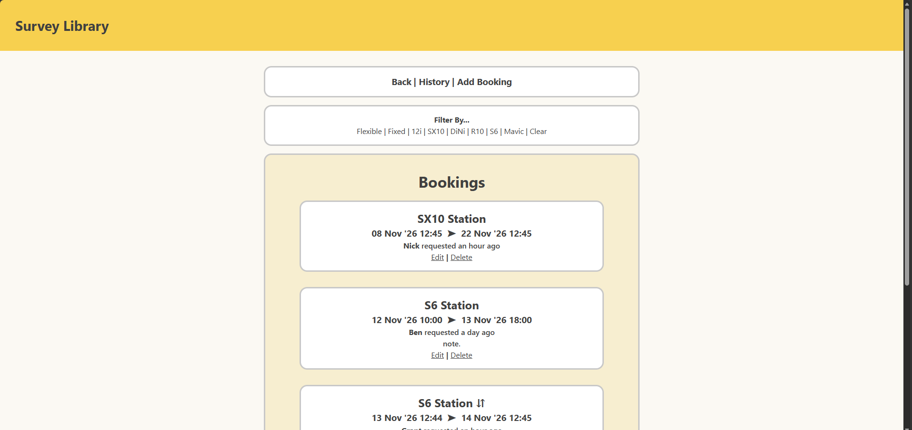

# Project Final Review and Reflection

## Addressing Relevant Implications

### Usability

I have kept things consistent to the best of my ability- using the same style and base template for each page type. All pages are minimal and all screens are accessible in one or two clicks. Flash messages appear after updating instruments, updating bookings, deleting bookings, and adding bookings. Information is sectioned off and links are kept in their own sections.

### Accessibility

Colour scheme is B/W/Y and contrast is essentially B/W except for a few uses- in which case I ran the combinations through a contrast checker (I used the Adobe contrast checker): \
#404040 -> text & #f1da8c-> background \

 

as well as #f7eed0 -> background

Screen is sectioned & pages stretch when screen gets bigger, though confined within a readable margin. Here is the bookings page fullscreen. 

### End-User

As much as I could, I got feedback from my dad & his workmates wherever possible. I attempted to slim down the text- flexibility is shown as "⇵" and an arrow is used between datetimes on the booking page- though images would have been best on the home page I did not manage to get to that. I still tried to keep everything as minimal as I could.

### Functionality

I did not do so well with this one- though the whole thing works (to my knowledge) and nothing was broken when I sent the live site through to my end-users, I haven't been so good with my documentation of the testing. I did not personally test the site on any other device than the machine I coded the site on at school. However, I emulated the site a few times and my users (when evaluating) used their work monitors.

### Aesthetics

I used a limited palette- a few yellow variations (header yellow Trimble yellow- eyedroppered from pictures of their instruments which I thought was funny) and shades of black & light grey. I used a simple layout and kept things mostly consistent, I hope...

## Overall Review

Replace these words with a brief review of how the project went in terms of:
- What went well?
    - My end-users think it's pretty cool, and I did have a lot of fun creating the whole project :)
- What didn't go so well?
    - My documentation could be a lot better- I got so caught up in the process of making something that I neglected to document it... 
- How did the testing/trialling impact the final system?
    - Relaying my ideas to my father as I built the system certainly helped. Things are pretty similar to the initial draft- I didn't get any hard shoves to different paths. Testing the thing (in my case, having the site up on a local channel as I worked) means that it's functional - even if it isn't documented I did hit errors and they had to be tackled as they appeared.
- What would you do differently if you could?
    - Do more documentation - have a reminder every time to "show my testing!" 
    - Ask the teacher about images to properly get them in the site. It would be so much easier to see things at a glance...