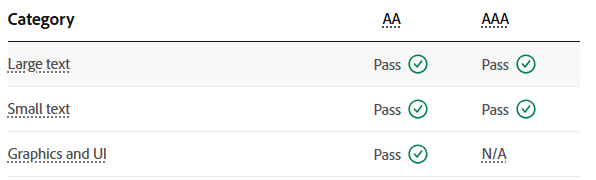

# Project Final Review and Reflection

## Addressing Relevant Implications

### Usability

I have kept things consistent to the best of my ability- using the same style and base template for each page type. All pages are minimal and all screens are accessible in one or two clicks. Flash messages appear after updating instruments, updating bookings, deleting bookings, and adding bookings. Information is sectioned off and links are kept in their own sections.

### Accessibility

Colour scheme is B/W/Y and contrast is essentially B/W except for a few uses- in which case I ran the combinations through a contrast checker (I used the Adobe contrast checker): \
#404040 -> text & #f1da8c-> background \

 

as well as #f7eed0 -> background

### NAME OF IMPLICATION 3

Replace this text with notes about what you did during the project to address the implication - design features, etc.

### NAME OF IMPLICATION 4

Replace this text with notes about what you did during the project to address the implication - design features, etc.

### NAME OF IMPLICATION 5

Replace this text with notes about what you did during the project to address the implication - design features, etc.

## Overall Review

Replace these words with a brief review of how the project went in terms of:
- What went well?
- What didn't go so well?
- How did the testing/trialling impact the final system?
- What would you do differently if you could?

